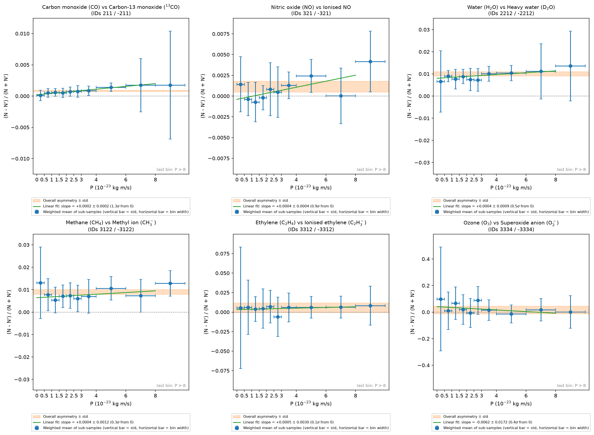
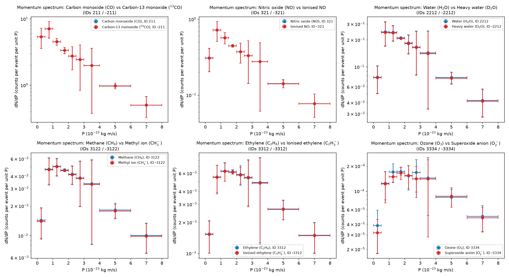

# PRA2003 - Simulating molecular emissions in a combustion reaction
**Student:** Henriette Rückert (i6397668) 

This code analyses 5 million simulated combustion events for 6 molecular species with their counterparts (12 IDs). It calculates average abundance and checks for asymmetries between paired species, as well as asymmetry as a function of their momentum

# Findings

| Normal ID | Normal molecule | Variant ID | Variant molecule |
|---:|---|---:|---|
| 211 | Carbon monoxide (CO) | −211 | Carbon-13 monoxide (¹³CO) |
| 321 | Nitric oxide (NO) | −321 | Ionised NO |
| 2212 | Water (H₂O) | −2212 | Heavy water (D₂O) |
| 3122 | Methane (CH₄) | −3122 | Methyl ion (CH₃⁻) |
| 3312 | Ethylene (C₂H₄) | −3312 | Ionised ethylene (C₂H₃⁻) |
| 3334 | Ozone (O₃) | −3334 | Superoxide anion (O₂⁻) |

Carbon monoxide, water and methane show a significant asymmetry: the normal molecule is produced slightly more often than its variant. Nitric oxide, ethylene and ozone are consistent with no asymmetry. No pair shows a dependence of the asymmetry on momentum. See Results.

# Dependencies

- **Python**: 3.8 or later

- **Dependencies**: Python3. Import matplotlib, numpy. If not installed:
- 
```bash
pip install numpy matplotlib
```

- **Input files**: output-Set1.txt through output-Set10.txt must be in the same directory as the script. Each line is either a header (eventNumber nParticles) or a particle row (px py pz moleculeID)

- **Run from repository**:
`week2deliverable.py`
`week3deliverable.py`
`week4deliverable.py`
`week5deliverable.py`

- **Runtime**: several minutes.

## Data ##

Each event in a file has:

- A Header line: eventID  and number of molecules rows
  
- The molecule rows contain: px py pz  and the moleculeID. These are the 3D momentum components with integer ID identifying the molecule

```
<event ID> <number of molecules>
<px> <py> <pz> <molecule ID>
<px> <py> <pz> <molecule ID>
...
```

## Input and output files ##

**Week 2:** The input is output-Set0.txt, the output is printed directly onto console


**Week 3:** The input is any of the output files, the output is printed directly onto console


**Week 4:** The input is 10 text files: output-Set1.txt --> output-Set10.txt, each containing 500,000 events (5,000,000 events total)

The output is printed directly onto console and into csv files:

`subsample_results.csv` = Per-code results for each of the 10 files separately 

`results.csv` = Pooled average per code across all 10 files, with sub-sampling uncertainty 

`significance.csv` = Pairwise difference, correlation, and significance test for each molecule/counterpart pair 


# Method #

**Week 2**

Reads one event from a single file, computes each particle's momentum magnitude, and prints everything to the console. An empty event is a real event where nothing happened, script excludes it from the event count N.

**Week 3**

It only handles one file and one chosen ID per run. Excludes empty events from N, and computes the uncertainty as the standard deviation of the mean. 

**Week 4**

1. Read one file, tally every known code per (non-empty) event. Keeps a running total per code:
   
- total_count: the sum of counts, used to get the mean
- Poisson: sqrt(N) / n_events
   
2. Combine the 10 files into one final average per code and takes the uncertainty as the standard deviation of the 10 per-file averages (sub-sampling method)
   
3. Pairwise test: for each code pair, the script computes the difference and asymmetry per file first, then the standard deviation of those per-file differences is the uncertainty on the difference. correlation_r is reported alongside as a diagnostic. **This was not included in the Week 5 code**

**Week 5**
Runs all three questions in one script! Also contains improvements on week 2-4/

For each pair, the script calculates:

1. **Counts per event**: the number of normal and of variant molecules, divided by the number of events.
2. **Overall asymmetry**: A using all molecules, plus how many standard deviations (σ) it is from zero.  
   - The asymmetry of a pair is: A = {N - N'}/{N + N'}
   - where N is the number of normal molecules and N' is the number of variant molecules.
   - A = 0 means both appear equally often
   - A > 0 means the normal molecule is more common
4. **Asymmetry vs momentum**: A in each momentum bin. Bin edges: 0, 0.5, 1, 1.5, 2, 2.5, 3, 4, 6, 8, and above 8.
5. **Momentum dependence**, tested in three ways:
   - the distance of each bin from the overall asymmetry, in σ
   - a straight-line fit A(P) = a + kP over 0 < P < 8, giving the slope k ± its error and how many σ it is from 0  (0 means no momentum dependence)
   - a list of the bins where |A| is more than 3σ from zero.
6. **Momentum spectrum dN/dP**: counts per event per unit momentum, for the normal and the variant molecule.


## How does the sub-sampling method work? ##

The 5 million event sample is split into 10 sub-samples of 500,000 events each and a central value is taken from the average over the full pooled sample. The statistical uncertainty is the standard deviation of the 10 sub-sample averages. This is used instead of propagating each molecule's uncertainty independently, since we don't know correlation between molecules measured in the same events.

# Questions
# What are the average counts of each molecular species and their statistical uncertainties?

| ID | Molecule | Average per event | Statistical uncertainty |
| --- | --- | --- | --- |
| 211 | Carbon monoxide | 19.949508 | ± 0.032746 |
| -211 | Carbon-13 monoxide | 19.917211 | ± 0.031873 |
| 321 | Nitric oxide | 2.509148 | ± 0.004774 |
| -321 | Ionised NO | 2.503457 | ± 0.005504 |
| 2212 | Water | 1.208034 | ± 0.001896 |
| -2212 | Heavy water (D2O) | 1.184161 | ± 0.002412 |
| 3122 | Methane (CH4) | 0.276599 | ± 0.001074 |
| -3122 | Methyl ion (CH3-) | 0.271696 | ± 0.000985 |
| 3312 | Ethylene (C2H4) | 0.039441 | ± 0.000284 |
| -3312 | Ionised ethylene (C2H3-) | 0.039000 | ± 0.000402 |
| 3334 | Ozone (O3) | 0.001187 | ± 0.000042 |
| -3334 | Superoxide anion (O2-) | 0.001152 | ± 0.000051 |

# Is there any asymmetry between the normal and the variant molecule?

For each molecule/counterpart pair, the difference and asymmetry are calculated per sub-sample first, then the standard deviation across sub-samples gives the uncertainty on the difference (n_sigma). This accounts for correlation between the pair. Pairs with n_sigma > 3 are significant. 

| Pair | Molecules | Counts per event (normal) | Counts per event (variant) | Overall asymmetry A | σ from 0 | Slope dA/dP (per 10⁻²³ kg m/s) | σ from 0 | Largest \|A − A<sub>overall</sub>\| / std |
|---|---|---|---|---|---|---|---|---|
| 211 / −211 | CO / ¹³CO | 19.949 ± 0.033 | 19.917 ± 0.032 | +0.00081 ± 0.00011 | **7.2** | +0.00022 ± 0.00017 | 1.3 | 0.9 |
| 321 / −321 | NO / Ionised NO | 2.5092 ± 0.0048 | 2.5035 ± 0.0055 | +0.00114 ± 0.00066 | 1.7 | +0.00036 ± 0.00043 | 0.9 | 0.9 |
| 2212 / −2212 | H₂O / D₂O | 1.2080 ± 0.0019 | 1.1842 ± 0.0024 | +0.0100 ± 0.0010 | **10.0** | +0.00042 ± 0.00086 | 0.5 | 0.5 |
| 3122 / −3122 | CH₄ / CH₃⁻ | 0.2766 ± 0.0011 | 0.2717 ± 0.0010 | +0.0089 ± 0.0011 | **8.4** | +0.0004 ± 0.0012 | 0.3 | 0.7 |
| 3312 / −3312 | C₂H₄ / C₂H₃⁻ | 0.03944 ± 0.00028 | 0.03900 ± 0.00040 | +0.0056 ± 0.0062 | 0.9 | +0.0005 ± 0.0030 | 0.1 | 0.5 |
| 3334 / −3334 | O₃ / O₂⁻ | 0.00119 ± 0.00004 | 0.00115 ± 0.00005 | +0.015 ± 0.029 | 0.5 | −0.006 ± 0.017 | 0.4 | 0.7 |

3 of 6 pairs show a significant asymmetry (> 3 sigma): Carbon monoxide, Water, and Methane.




  
# Is there any asymmetry as a function of their momentum?
## Plots

**`asymmetry_vs_P.png`** has one panel per pair, showing:
- Blue points: the asymmetry in each bin. The vertical bar is the std of the sub-samples. The horizontal bar is the bin width
- Orange band: the overall asymmetry ± its std
- Green slope: the straight-line fit, with the slope given in the legend
- Dashed grey line: A = 0

**`spectrum_dNdP.png`** has one panel per pair, with the normal molecule in blue and the variant in red, on a log scale. The open last bin (P > 8) is not included, because it has no real width.

## Asymmetry as a function of momentum interpretation

No pair shows a significant dependence of the asymmetry on momentum:

every bin agrees with the pair's overall asymmetry within 1σ (largest deviation 0.9σ);
every fitted slope is consistent with zero (largest is CO, at 1.3σ).

Two water bins (0.5–1 and 3–4) are more than 3σ from zero. That is only because the overall water asymmetry is not zero: both bins agree with the overall value within 0.4σ, so they are not evidence that the asymmetry depends on momentum.

## dNdP interpretation

For every pair, the normal and variant molecules have the same momentum spectrum within the uncertainties. The spectrum rises to a peak somewhere between P ≈ 0.5 and 2 × 10⁻²³ kg m/s and then falls at higher P. This agrees with the asymmetry not depending on momentum.

In every pair, the dN/dP points between P ≈ 2.5 and 4 have larger uncertainties than their neighbours. This means the shape of the spectrum varies more between sub-samples in that range. The asymmetry there is not affected, because the variation is the same for the normal and the variant molecule and cancels in the ratio.

**BUT** our group investigated why this happens:

Sub-sample 10: its momentum distribution differs from the other nine, for an unknown reason. It is kept in the main results (see Sub-sample 10). Because of it, the momentum spectra have large error bars. This is a **limitation**


### Sub-sample 10: different momentum spectrum

**How it was found**

1. The momentum spectra had very large error bars. The error bars are the spread between sub-samples, so this pointed to sub-samples that disagree
2. The number of molecules per event in each momentum bin was compared file by file. Files 1–9 agree closely but file 10 doesn;t

Example for methane / methyl ion (3122 / −3122), N + N' per event in each momentum bin:

| P bin | 0–0.5 | 0.5–1 | 1–1.5 | 1.5–2 | 2–2.5 | 2.5–3 | 3–4 | 4–6 | 6–8 | > 8 | **Total** |
|---|---|---|---|---|---|---|---|---|---|---|---|
| File 1 | 0.0158 | 0.0522 | 0.0539 | 0.0474 | 0.0393 | 0.0323 | 0.0506 | 0.0682 | 0.0446 | 0.1473 | **0.552** |
| Files 2–9 | 0.0154–0.0160 | 0.0509–0.0518 | 0.0530–0.0537 | 0.0459–0.0469 | 0.0386–0.0395 | 0.0322–0.0328 | 0.0503–0.0512 | 0.0679–0.0685 | 0.0437–0.0446 | 0.1456–0.1472 | |
| **File 10** | **0.0004** | **0.0067** | **0.0219** | **0.043** | **0.0671** | **0.0909** | **0.21** | **0.1075** | **0.0018** | **0.0005** | **0.550** |
| Relative spread (all 10 files) | 0.34 | 0.30 | 0.20 | 0.03 | 0.21 | 0.48 | 0.76 | 0.17 | 0.34 | 0.35 | |

**What is different about file 10**

- File 10 contains **the same number of molecules per event** as the other files (0.550 against 0.552 for methane).
- Those molecules have a **different momentum distribution**

The cause of this difference is not known.

**Effect on the momentum spectrum**

Without file 10, the error bars on the momentum spectrum become much smaller:


**All 10 files are kept**

File 10 has the same number of molecules per event as the other files, so it is valid for the counts per event and the overall asymmetry.

## Notes and limitations

- Rare pairs: some pairs, such as ozone / superoxide, have very few molecules. Their asymmetries have large uncertainties.
- Bins not plotted: a bin is left off the asymmetry plot if fewer than 2 sub-samples have molecules in it, or if its std is 0.
- What a zero slope means: a slope consistent with zero does not prove the asymmetry is independent of P (it could rise and then fall). The per-bin comparison with the overall asymmetry looks at that
- For every pair, the normal and variant molecules have the same momentum spectrum within the uncertainties. The spectrum rises to a peak somewhere between P ≈ 0.5 and 2 × 10⁻²³ kg m/s and then falls at higher P. This agrees with the asymmetry not depending on momentum.

